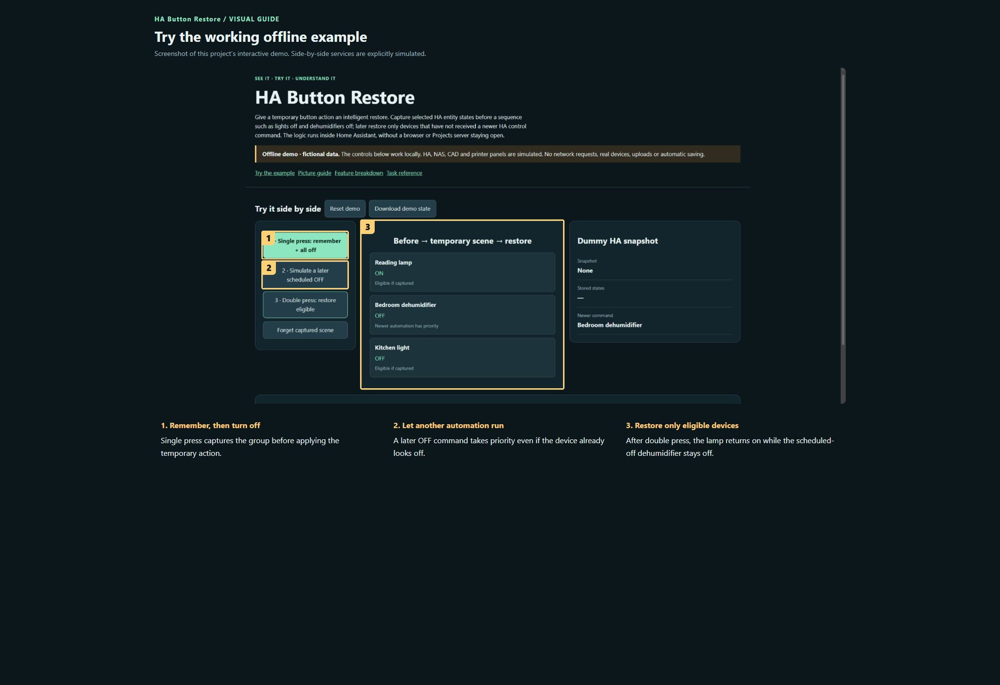

# HA Button Restore

**Maintaining this project? [Start here](docs/START-HERE.md) · [Detailed handover](docs/HANDOVER.md)**

Give a temporary button action an intelligent restore. Capture selected HA entity states before a sequence such as lights off and dehumidifiers off; later restore only devices that have not received a newer HA control command. The logic runs inside Home Assistant, without a browser or Projects server staying open.

[Publication checks and remaining limits](docs/PUBLICATION.md)

**Public source preview · MIT for original contributions.**

[Open the visual manual](docs/USER-MANUAL.md) · [Download the self-contained demo](demo.html) · [Release notes](CHANGELOG.md)

Download `demo.html` using GitHub’s Download raw file control, then open it in your browser. GitHub displays HTML source; it does not run the demo on this page. The demo is an offline simulation with fictional data and makes no network requests.

## See it

### Try the working offline example

Screenshot of this project’s interactive demo. Side-by-side services are explicitly simulated.

1. **Remember, then turn off.** Single press captures the group before applying the temporary action.
2. **Let another automation run.** A later OFF command takes priority even if the device already looks off.
3. **Restore only eligible devices.** After double press, the lamp returns on while the scheduled-off dehumidifier stays off.

## What this tool does

| Feature | What it lets you do | Where |
| --- | --- | --- |
| Capture | Remember selected entity states under a named key before changing them. | HA action |
| Restore | Restore eligible captured entities once using the same key. | HA action |
| Later-command priority | A newer HA service command invalidates restoration for that device, even if its displayed state did not change. | Automatic |
| Physical-device grouping | Related control entities on the same registered device invalidate together. | Automatic |
| Clear | Discard a remembered group without restoring it. | HA action |
| Button-independent | Works with any button integration that exposes usable triggers; this component does not discover press types. | Integration boundary |

## A first useful workflow

### Understand the sequence

1. Suppose a lamp is on. A single press captures that state, then switches the lamp off for a temporary scene.
2. A double press restores the lamp only if no newer HA command has claimed it. If a scheduled lights-off automation ran in the meantime, the lamp stays off.
3. Use the same key for capture and restore. Separate unrelated buttons/scenes with different keys to avoid replacing each other’s snapshots.

## Saving and outputs

Snapshots exist in HA memory. They are not a database or a cross-restart backup. A failed capture clears an old snapshot and stops the sequence; all requested entities must be available at capture time.

## Running the actual tool

Install the component under /config/custom_components/mungoon_button_restore, restart HA and add Layout Studio button restore.

The demo has no prerequisites; the real tool may need the services described in the manual and retained source notes.

## Current boundaries

Direct changes through a physical remote or vendor application may not produce a HA service event and are not universally tracked. This is targeted restore, not general undo. Eight policy tests passed previously; a clean HA installation has not been rerun for this documentation update.

## Licence and sharing

MIT applies to original project contributions. Bundled/upstream software and assets retain their own terms; see [third-party notes](THIRD-PARTY.md). Keep this repository private until its own [release checklist](RELEASE-CHECKLIST.md) is complete and the owner authorises publication.

## Install the integration

Follow the retained [installation and setup guide](docs/button-restore.md), then use the numbered screenshot manual above to understand the workflow.
