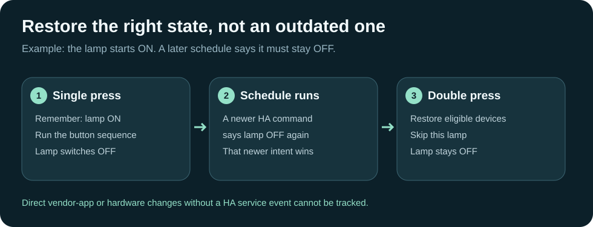

# HA Button Restore: remember, act, restore

[Numbered screenshot manual](USER-MANUAL.md) · [Try the offline example](../demo.html)

Use one button action to remember device states before a sequence, then another
press to restore the devices that have not received a newer HA command.
For example: turn several lights off temporarily, then restore their earlier
states without undoing a newer scheduled lights-off command.

## Install in Home Assistant

1. Make a Home Assistant backup.
2. Copy the `mungoon_button_restore` folder from
   `projects-host/ha-custom-components` into HA's `/config/custom_components/`.
3. Check the HA configuration and restart HA.
4. Open **Settings → Devices & services → Add integration** and search for
   **Layout Studio button restore**.
5. Create your automation in HA. First call `mungoon_button_restore.capture`
   with a unique `key` and the affected `entity_id` list, then run the actions.
6. For the double-press (or another trigger), call
   `mungoon_button_restore.restore` with the same key.

Use your button integration's actual supported triggers. This component does
not discover press types or assign a physical button automatically.

## Try the example safely

Read `examples/button-restore-scripts.yaml`. Replace the example light ID with
a test light you control. Add the two script definitions to your HA script
configuration using your normal configuration workflow. Run the first script,
then the restore script. Once tested, call those scripts from your button triggers.
Do not leave the sample entity ID unchanged and expect it to control a device.

## What happens when another automation runs?

A newer HA control command takes priority for the affected device, even when
the command leaves its visible state unchanged. Restoring the button snapshot
skips that device while eligible devices can still return to their earlier states.
Alternate control entities registered to the same physical device invalidate
together. This prevents a fan control from accidentally undoing a later command
through the same dehumidifier's other entity.

## Important limits

Snapshots live only in HA memory. They disappear after restart, integration
unload or scene reload, and can be restored only once. Reapplying replaces the
earlier snapshot. All requested entities must be available at capture time;
failed capture clears an old snapshot and stops the sequence.

Changes made directly through a physical remote or vendor app without a HA
service event are not tracked. This is not a universal undo button. The component
uses HA internals; verify compatibility after HA upgrades and test using a spare
light before applying it to a larger group.

No Projects server, external account, token or browser tab is needed at runtime.
